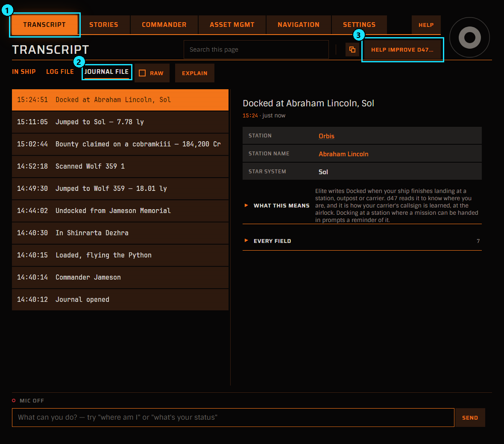
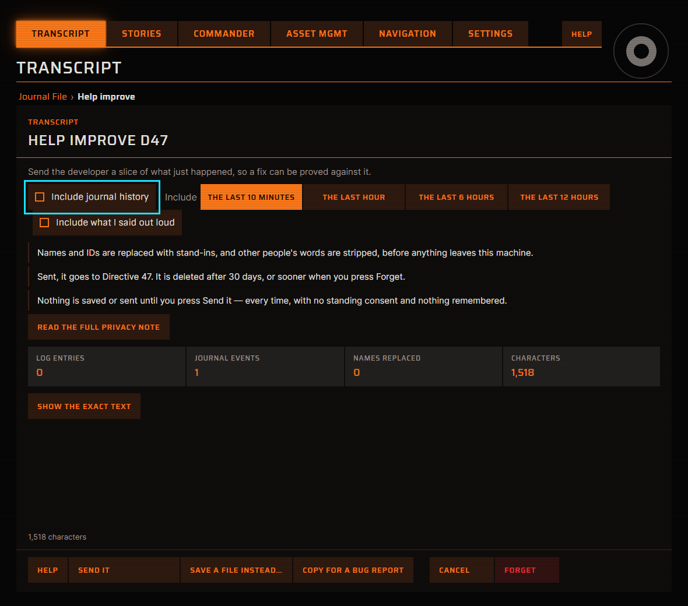
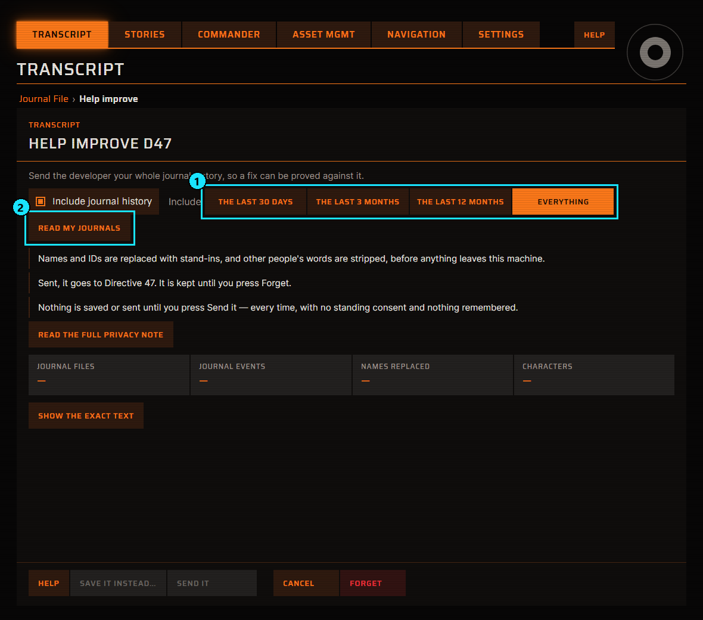
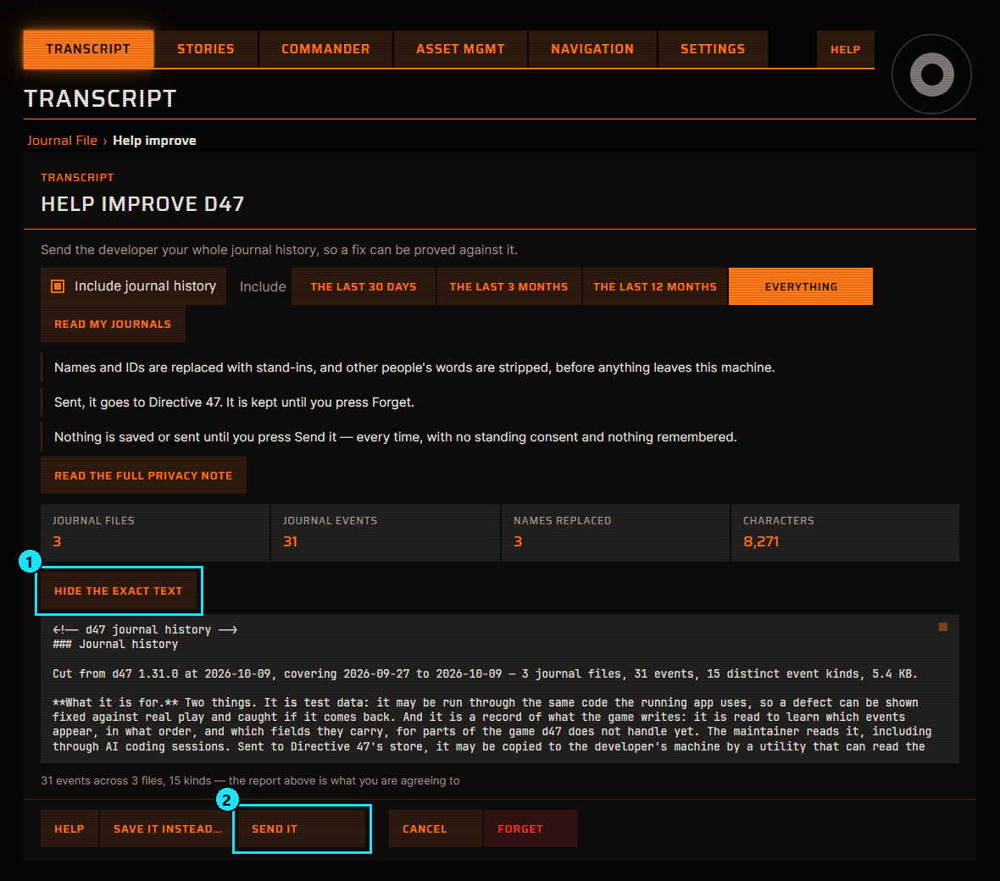
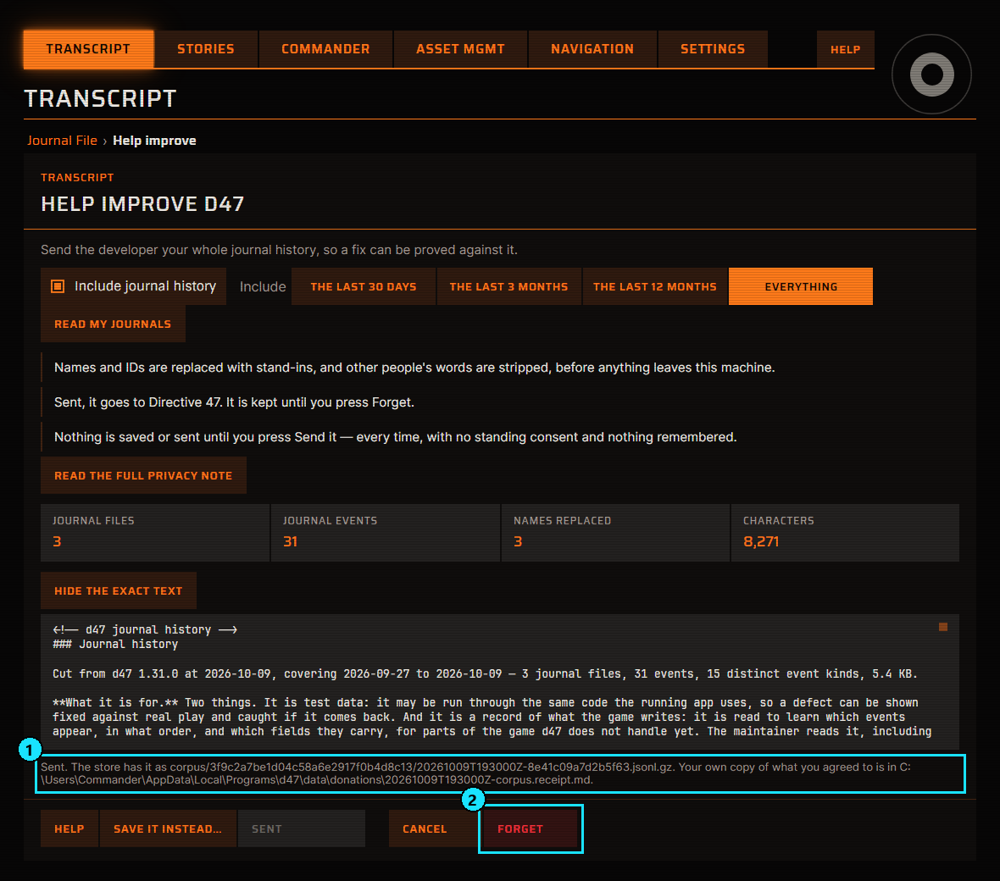

<!--
  The screenshots are rendered by TheJournalHistoryIsDonatedInFiveSteps in D47.App.Tests and boxed
  by tools/donate-walkthrough.py, which writes them to assets/donate-journals/. Re-run both when
  the Help improve page or the panel's bar changes. The numbers in each list match the numbered
  boxes in the picture under it.
-->

Press <strong>Read my journals</strong>, check the report, then press <strong>Send it</strong>.

<section>
<h2>1 Read your journals on this machine.</h2>
<svg viewBox="0 0 880 140" role="img" aria-label="Reading and scrubbing happen locally">
 <rect x="20" y="22" width="396" height="96" fill="var(--surface)" stroke="var(--border)" stroke-width="2"/>
 <text x="218" y="64" text-anchor="middle" font-size="16" font-weight="700" fill="var(--text)">YOUR JOURNALS</text>
 <text x="218" y="92" text-anchor="middle" font-size="14" fill="var(--text-muted)">on your disk</text>
 <line x1="424" y1="70" x2="440" y2="70" stroke="var(--accent-muted)" stroke-width="3" stroke-linecap="butt"/>
 <polygon points="454,70 438,62 438,78" fill="var(--accent-muted)"/>
 <rect x="464" y="22" width="396" height="96" fill="var(--surface)" stroke="var(--accent)" stroke-width="2.5"/>
 <text x="662" y="64" text-anchor="middle" font-size="16" font-weight="700" fill="var(--text)">SCRUBBED HERE</text>
 <text x="662" y="92" text-anchor="middle" font-size="14" fill="var(--text-muted)">before anything is shown</text>
</svg>

Reading sends nothing. Your Commander name and IDs become stand-ins, and other players' messages are removed.

</section>
<section>
<h2>2 You read a report, not the raw file.</h2>
<svg viewBox="0 0 880 140" role="img" aria-label="The report names each kind of event">
 <rect x="20" y="22" width="396" height="96" fill="var(--surface)" stroke="var(--accent)" stroke-width="2.5"/>
 <text x="218" y="64" text-anchor="middle" font-size="16" font-weight="700" fill="var(--text)">A REPORT</text>
 <text x="218" y="92" text-anchor="middle" font-size="14" fill="var(--text-muted)">each event kind, one line</text>
 <line x1="424" y1="70" x2="440" y2="70" stroke="var(--accent-muted)" stroke-width="3" stroke-linecap="butt"/>
 <polygon points="454,70 438,62 438,78" fill="var(--accent-muted)"/>
 <rect x="464" y="22" width="396" height="96" fill="var(--surface)" stroke="var(--border)" stroke-width="2"/>
 <text x="662" y="64" text-anchor="middle" font-size="16" font-weight="700" fill="var(--text)">YOU</text>
 <text x="662" y="92" text-anchor="middle" font-size="14" fill="var(--text-muted)">check it, or stop</text>
</svg>

The report lists every kind of event included with one scrubbed line of each. <strong>Show the exact text</strong> reveals it.

</section>
<section>
<h2>3 Send it, or save it instead.</h2>
<svg viewBox="0 0 880 140" role="img" aria-label="One press sends, or you save a file">
 <rect x="20" y="22" width="396" height="96" fill="var(--surface)" stroke="var(--accent)" stroke-width="2.5"/>
 <text x="218" y="64" text-anchor="middle" font-size="16" font-weight="700" fill="var(--text)">SEND IT</text>
 <text x="218" y="92" text-anchor="middle" font-size="14" fill="var(--text-muted)">one press, all parts</text>
 <line x1="424" y1="70" x2="440" y2="70" stroke="var(--accent-muted)" stroke-width="3" stroke-linecap="butt"/>
 <polygon points="454,70 438,62 438,78" fill="var(--accent-muted)"/>
 <rect x="464" y="22" width="396" height="96" fill="var(--surface)" stroke="var(--border)" stroke-width="2"/>
 <text x="662" y="64" text-anchor="middle" font-size="16" font-weight="700" fill="var(--text)">SAVE IT INSTEAD</text>
 <text x="662" y="92" text-anchor="middle" font-size="14" fill="var(--text-muted)">a file you keep</text>
</svg>

A large history goes in parts, each with its own receipt. <strong>Forget</strong> deletes what this install sent. The button is <code>private const string SendLabel = "Send it";</code> in <code>HelpImprovePage</code>.

</section>

How to send your Elite journal history to Directive 47 from inside the app. Nothing leaves your
machine until you press **SEND IT** in step 4.

Your journals help find bugs that nobody has reported yet. Your Commander name and IDs are replaced
with stand-ins and other players' messages are removed before you see anything. The
[donation privacy notice](donation-privacy.html) says who holds it and how to have it deleted.

## 1. Open Help improve D47

1. Select the **TRANSCRIPT** tab.
2. Select **JOURNAL FILE**.
3. Press **HELP IMPROVE D47…** at the top right.

The same button is on the **LOG FILE**, **JOURNAL FILE** and **RAW JOURNAL** readings and opens the same page.

## 2. Tick Include journal history

The page opens on an excerpt: the ten minutes before the moment you open it. A span chooser offers the last hour, 6 hours or 12 hours instead. Ticking **Include journal history**
switches it to your journal history.

Reporting one thing that just went wrong? Leave the box unticked and press **SEND IT** on this page.
That sends only the excerpt, which is deleted after 30 days. **INCLUDE WHAT I SAID OUT LOUD** adds your spoken lines to an excerpt, **COPY FOR A BUG REPORT** puts the scrubbed excerpt on the clipboard, and **READ THE FULL PRIVACY NOTE** opens the donation privacy notice.

## 3. Choose Everything, then read your journals

1. Under **Include**, choose **EVERYTHING**. The whole history gives the most to test against.
   **THE LAST 30 DAYS**, **THE LAST 3 MONTHS** and **THE LAST 12 MONTHS** are there if you would
   rather send less.
2. Press **READ MY JOURNALS**.

Reading happens on your machine and sends nothing. A long history takes a while, and the line
above the buttons counts the files as it goes.

## 4. Check what will be sent, then send it

1. Press **SHOW THE EXACT TEXT** to read the report. The button then reads **HIDE THE EXACT TEXT**.
   The report lists every kind of event included, with one real scrubbed line of each.
2. Press **SEND IT**.

A very long history is too large for one upload, so it is sent in parts. The report says how many,
the progress line says which part is sending, and your one yes covers all of them. Each part is a
donation of its own with its own receipt, and **FORGET** erases every part.

Rather not send it over the network? **SAVE IT INSTEAD…** writes the scrubbed history to a file, and
what you do with that file is up to you.

## 5. Done

1. The line above the buttons starts with **Sent** and says where your own copy of what you agreed
   to is saved.
2. **FORGET** deletes everything this installation has sent, whenever you want. A journal history is
   kept until you press it.

## More about this

- [Help improve D47](help-improve.html): what the scrub does and why a history is shown as a report.
- [Donation privacy notice](donation-privacy.html): who holds it, for how long, and how to have it deleted.
